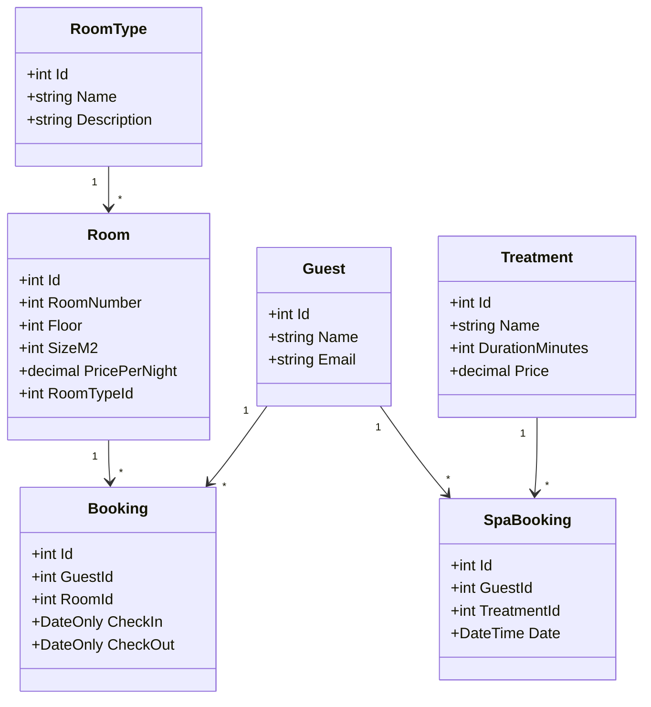

# Hotel Grandioso

Ett bokningssystem för Hotel Grandioso som ersätter det gamla Excel-arket. Programmet är en konsolapp i C# som använder EF Core (Code First) och SQLite.

## Så kör du projektet

Du behöver .NET 10 SDK.

```bash
git clone https://github.com/Akarshika1992/Hotel-Grandioso.git
cd "Hotel-Grandioso/Hotel Grandioso"
dotnet run
```

Databasen skapas automatiskt första gången man startar programmet. Då läggs hotellets 15 rum och spabehandlingarna in. Migrationerna ligger i mappen `Migrations`.

## Vad programmet kan göra

1. Boka rum (jag räknar ut totalpriset, antal nätter gånger pris per natt)
2. Avboka en bokning
3. Visa alla aktuella bokningar
4. Visa alla rum med typ och pris

<!--
VG, ta bort kommentaren när det är klart:
- Förhindra dubbelbokning
- Visa lediga rum för ett datumintervall
- Boka spa
-->

## UML-diagram



### Relationerna

- En rumstyp har många rum. Jag gjorde RoomType till en egen tabell så att namn och beskrivning inte behöver skrivas om på varje rum. Storlek och pris ligger på Room, för två Standard-rum på olika våningar har olika storlek och pris.
- Ett rum kan ha många bokningar (över tid), men en bokning gäller bara ett rum.
- En gäst kan ha många bokningar, men en bokning har en gäst. Booking kopplar alltså ihop en gäst med ett rum och två datum.
- En gäst kan ha många spabokningar och en behandling kan bokas många gånger. SpaBooking kopplar ihop gäst och behandling med en tid.
- Jag använder DateOnly för in- och utcheckning eftersom man bokar hela dagar, och DateTime för spa eftersom man bokar en tid.

## Hur koden är uppdelad

- **Models**: klasserna för entiteterna.
- **Data/HotelContext**: EF Core-inställningar, unika index och startdata.
- **Repositories/HotelRepository**: all kod som pratar med databasen.
- **Services/BookingService**: reglerna, t.ex. att utcheckning måste vara efter incheckning, och prisberäkningen.
- **UI/ConsoleMenu**: menyn, den skriver och läser bara i konsolen.
- **Program.cs**: skapar objekten och startar menyn.

## Repository

HotelRepository är klassen som gör allt arbete mot databasen. Den hämtar rum, hittar eller skapar gäster, sparar och tar bort bokningar och hämtar aktuella bokningar. Allt görs med LINQ, inga SQL-strängar.

Jag gjorde så här för att menyn och servicen inte ska behöva känna till EF Core. Då ligger alla databasfrågor på ett ställe, och om jag vill ändra en fråga behöver jag bara ändra på ett ställe.

<!--
VG, ta bort kommentaren när dubbelbokningsskyddet är klart:

## Dubbelbokning

Innan en bokning sparas kollar jag om rummet redan är bokat under de datumen:

```csharp
bool upptaget = await _context.Bookings.AnyAsync(b =>
    b.RoomId == booking.RoomId &&
    b.CheckIn < booking.CheckOut &&
    b.CheckOut > booking.CheckIn);
```

Två bokningar överlappar om båda börjar innan den andra slutar. AnyAsync ger true om det finns någon sådan bokning för rummet, och då sparas inte den nya. Jag använder < och > (inte <= och >=) så att en gäst kan checka in samma dag som en annan checkar ut.
-->

## GDPR

Jag har gått igenom fälten på Guest som hotellchefen ville ha. Jag utgår från att man bara ska spara det man faktiskt behöver (dataminimering).

- **Name**: behåller jag. Man måste veta vem som har bokat.
- **Email**: lade jag till själv. Hotellet behöver kunna skicka bokningsbekräftelse, och med e-post kan man skilja två gäster med samma namn åt.
- **HairColor**: tar bort. Hårfärg har inget med en bokning att göra.
- **HeightCm**: tar bort. Längd behövs inte för att boka rum, och det är bara en onödig personuppgift att skydda.
- **Religion**: tar bort. Religion är känsliga personuppgifter enligt GDPR (artikel 9) och det är i princip förbjudet att spara dem utan uttryckligt samtycke. Det behövs inte för en bokning och skulle vara allvarligt om det läckte. Om hotellet vill erbjuda t.ex. ett bönerum kan gästen skriva ett önskemål vid bokningen istället, utan att religionen sparas på gästen.

Jag valde också att en avbokning tar bort bokningen helt, så att vi inte sparar uppgifter om en bokning som aldrig blev av.