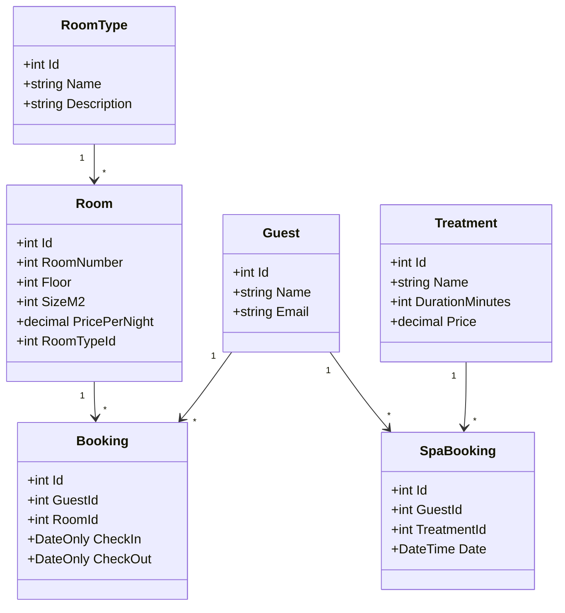

# Hotel Grandioso

Det här är ett bokningsprogram för Hotel Grandioso. Det ersätter det gamla Excel-arket. Programmet körs i konsolen och är skrivet i C# med EF Core och SQLite.

## Så här kör du programmet

Du behöver .NET 10 SDK.

```bash
git clone https://github.com/Akarshika1992/Hotel-Grandioso.git
cd "Hotel-Grandioso/Hotel Grandioso"
dotnet run
```

Databasen skapas av sig själv första gången du startar programmet. Då läggs hotellets 15 rum in. Migrationerna finns i mappen `Migrations`.

## Vad programmet kan göra

1. Boka rum. Programmet räknar ut totalpriset (antal nätter gånger pris per natt).
2. Avboka en bokning.
3. Visa alla bokningar som inte är slut än.
4. Visa alla rum med typ och pris.
5. Programmet stoppar dubbelbokning. Samma rum kan inte bokas två gånger för samma datum.

## UML-diagram



### Varför relationerna ser ut så här

- En rumstyp har många rum. Jag gjorde en egen tabell för rumstyp, så att namnet och beskrivningen bara finns på ett ställe. Storlek och pris ligger på rummet, för rummen på olika våningar har olika storlek och pris.
- Ett rum kan bokas många gånger, men varje bokning gäller bara ett rum.
- En gäst kan göra många bokningar, men varje bokning har bara en gäst. Bokningen kopplar ihop en gäst med ett rum och två datum.
- Spabokningen kopplar ihop en gäst med en behandling och en tid. Många gäster kan boka samma behandling.
- Jag använder DateOnly för in- och utcheckning, eftersom man bokar hela dagar. För spa använder jag DateTime, eftersom man bokar en tid.

## Hur koden är uppdelad

- Models: klasserna som beskriver datan.
- Data/HotelContext: inställningar för databasen och startdata (rum och behandlingar).
- Repositories/HotelRepository: all kod som pratar med databasen.
- Services/BookingService: reglerna, till exempel att utcheckning måste vara efter incheckning. Här räknas också priset ut.
- UI/ConsoleMenu: menyn. Den skriver och läser bara i konsolen.
- Program.cs: skapar objekten och startar menyn.

## Repository

HotelRepository är klassen som gör allt jobb mot databasen. Den hämtar rum, hittar eller skapar gäster, sparar och tar bort bokningar och hämtar bokningar. Den kollar också om ett rum redan är bokat innan en bokning sparas. Allt görs med LINQ, jag har ingen SQL-text i koden.

Jag gjorde så för att menyn och servicen inte ska behöva veta hur databasen fungerar. Alla frågor till databasen ligger på ett ställe, så om jag vill ändra något behöver jag bara ändra där.

## Dubbelbokning

Innan en bokning sparas kollar programmet om rummet redan är bokat de datumen:

```csharp
bool upptaget = await _context.Bookings.AnyAsync(b =>
    b.RoomId == booking.RoomId &&
    b.CheckIn < booking.CheckOut &&
    b.CheckOut > booking.CheckIn);
```

Två bokningar krockar om båda börjar innan den andra slutar. `AnyAsync` svarar true om det finns minst en sådan bokning för samma rum. Då sparas inte den nya bokningen och användaren får ett felmeddelande.

Jag använder `<` och `>` och inte `<=` och `>=`. Då kan en gäst checka in samma dag som en annan gäst checkar ut.

Exempel: rummet är bokat 15 till 18 december.
- 16 till 20 december krockar och nekas.
- 18 till 20 december krockar inte och är okej.

## GDPR

Jag har tittat på fälten som hotellchefen ville ha på gästen. Jag sparar bara det som behövs för en bokning. Det kallas dataminimering.

- Name: jag behåller det. Hotellet måste veta vem som har bokat.
- Email: jag lade till det själv. Hotellet behöver kunna skicka en bekräftelse. Med e-post kan man också skilja två gäster med samma namn åt.
- HairColor: jag tar bort det. Hårfärg har ingenting med en bokning att göra.
- HeightCm: jag tar bort det. Längd behövs inte för att boka ett rum. Det är bara en onödig uppgift som hotellet måste skydda.
- Religion: jag tar bort det. Religion är en känslig personuppgift i GDPR (artikel 9) och man får i princip inte spara den utan tydligt samtycke. Hotellet behöver den inte för en bokning, och det vore allvarligt om den läckte. Om hotellet vill erbjuda till exempel ett bönerum kan gästen skriva ett önskemål när hen bokar, utan att religionen sparas.

När man avbokar tar programmet bort bokningen helt. Då sparar vi inte uppgifter om en bokning som aldrig blev av.